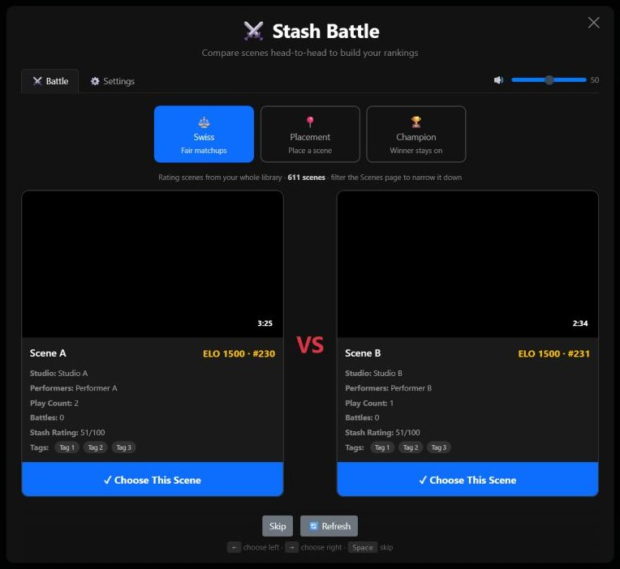
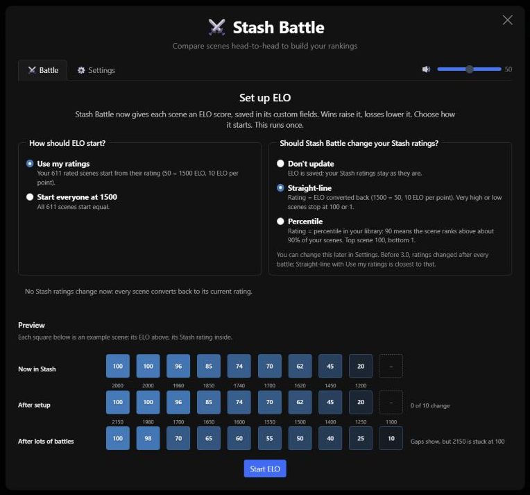
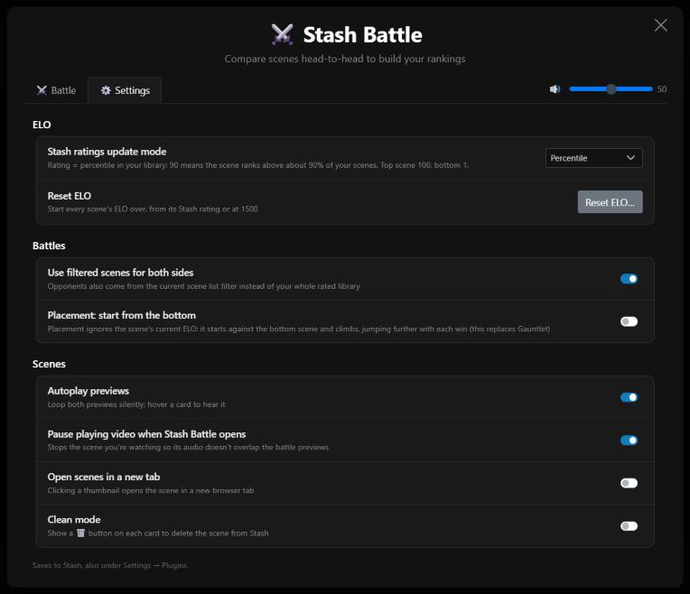
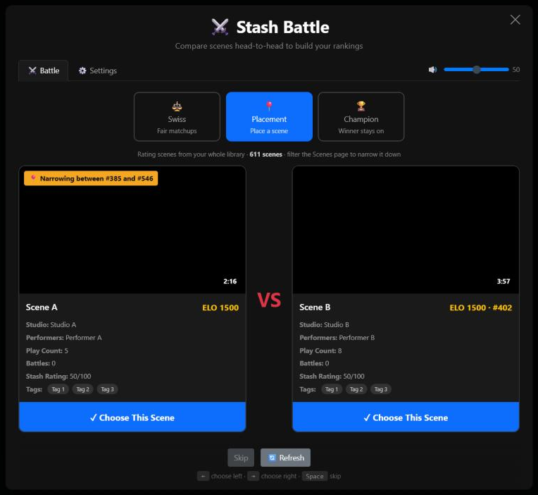
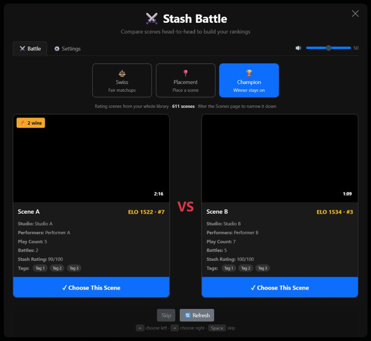

# ⚔️ Stash Battle

A head-to-head scene comparison plugin for [Stash](https://stashapp.cc/) that uses a true ELO rating system to help you rank your scenes.

## Overview

Stash Battle presents you with two scenes side-by-side and asks you to pick the better one. Every scene gets its own ELO score, the same kind of rating chess uses: winning raises it, losing lowers it, and beating a stronger scene earns more than beating a weaker one. Over time this builds an accurate ranking of your entire library based on your personal preferences.

ELO is saved in each scene's custom fields, so **Stash Battle doesn't touch your Stash star ratings unless you ask it to**. If you'd like your ratings to follow your rankings, switch on a Stash ratings update mode.

## Requirements

- **Stash v0.31.0 or newer** (the version that added custom fields to scenes, where ELO is stored). On an older Stash, Stash Battle shows a message instead of loading.

## Features

- **Three Comparison Modes:**
  - **Swiss** ⚖️ – Fair matchups between scenes with similar ELO. Both scenes' ELO changes after every pick. Scenes stay in the pool, so you can keep battling a small filter indefinitely.
  - **Placement** 📍 – Place a scene fast. Each pick narrows the range of ranks it could land in (shown on its card). A rated scene starts near its current rank and takes bigger jumps while it keeps winning or losing, then bounces back with smaller steps once it overshoots. An unrated scene lands in about 10 picks even in a library of 500+ scenes. Only the placed scene's ELO changes, once, when it lands.
    - **Start from the bottom** (a setting, and the replacement for Gauntlet): the scene ignores its current ELO, starts against your lowest scene and climbs, jumping further with each win (never more than a tenth of your library at once). A scene that never loses earns the Champion screen.
  - **Champion** 🏆 – Winner stays on. The winning scene keeps defending until it's beaten, then the winner takes over. Both scenes' ELO changes every pick.

- **One-time ELO setup**: the first time you open Stash Battle, choose how ELO starts (from your current star ratings, so your existing order carries over, or 1500 for every scene) and whether Stash ratings should be updated. A live preview shows what each choice does. You can start over any time with **Reset ELO** in Settings.

- **Stash ratings update mode** (Settings): your choice of whether Stash Battle writes your Stash ratings:
  - **Don't update** (default): ELO is saved; your star ratings stay as they are.
  - **Straight-line**: rating = ELO converted back (1500 = 50, 10 ELO per point). Very high or low scenes stop at 100 or 1.
  - **Percentile**: rating = percentile in your library. 90 means the scene ranks above about 90% of your scenes; the top scene is 100, the bottom 1.

  Switching to Straight-line or Percentile tells you how many ratings will change before anything is written. While an update mode is on, each battle updates only the ratings that changed, and Stash's own pages show the new ratings without a refresh.

- **Filtering**: Apply any filters on the scenes page before opening Stash Battle. What you see on the scenes page is what you get in Stash Battle, in every mode; a line above the cards shows whether you're rating your filter or your whole library, and how many scenes that is. By default, filtered scenes appear on the left (scenes to rate) and opponents come from your full library on the right.

- **Scene cards** show each scene's ELO and rank (`ELO 1740 · #50`), how many battles it has had, and its Stash rating.

- **On Stash's scene pages**, the same `ELO 1740 · #50` sits next to the play count and O count, with a ⚔ icon. Click it to battle that scene.

- **Settings tab** (next to the Battle tab; most also under Stash's Settings → Plugins). Saves to Stash:
  - **Stash ratings update mode** and **Reset ELO** (see above)
  - **Use filtered scenes for both sides**
  - **Placement: start from the bottom**
  - **Autoplay previews** – both loop silently; hover a card to hear it (on by default)
  - **Pause playing video when Stash Battle opens** – on by default; turn it off to keep a scene playing behind the battle
  - **Open scenes in a new tab** when clicking a thumbnail
  - **Clean mode** – a 🗑 button on each card opens Stash's own delete dialog (same options and defaults as deleting in Stash), so you can clean up without leaving the battle

- **Preview volume** slider on the tab bar (it follows perceived loudness); click the speaker to mute or unmute.

- **Works on phones and tablets**: the cards stay side by side on tablets, stack compactly on phones, and Skip stays pinned at the bottom. On touch screens, tap a thumbnail to play its preview, use ↗ to open the scene, and tap ⓘ next to the modes for an explanation of the current mode.

- **SFW Switch support**: thumbnails and previews blur when the [SFW Switch](https://github.com/stashapp/CommunityScripts) plugin's SFW mode is on.

## Screenshots

| ELO setup | Settings |
|-----------|----------|
|  |  |

| Placement mode | Champion mode |
|----------------|---------------|
|  |  |

## Installation

⚠️ Install at your own risk, nearly entirely vibe coded for myself but I review (some) of the code and test as thoroughly as I can.

Recommend saving a backup of your database beforehand (Settings → Tasks → Backup) just in case, especially before turning on a Stash ratings update mode.

### Source Index:

1. Add this repo's source index: `https://dtt-git.github.io/stash-battle/main/index.yml` to Stash plugin sources
2. Checkbox the Stash Battle package and click Install

### Manual Download:
1. Download the `/plugins/stash-battle/` folder to your Stash plugins directory

## Usage

1. Navigate to the **Scenes** page in Stash
2. (Optional) Apply any filters or search to narrow down which scenes you want to rate (the line above the cards confirms what you're rating)
3. Click the **Battle** button in the navbar
4. The first time, set up ELO: choose how it starts and whether your Stash ratings should be updated
5. Choose a mode (hover a mode, or tap ⓘ on a phone, for a short explanation)
6. Click a scene (or press ← / →) to pick the winner; Space skips the pair
7. Watch your rankings evolve over time!

You can also open Stash Battle on a scene page (the **Battle** button, or the ELO next to the play count), which puts that scene into a battle right away.

Settings live in the **Settings** tab next to **Battle**.

## How It Works

Every scene gets an ELO score, stored in its custom fields (`stash_battle_elo`, alongside `stash_battle_battles` and `stash_battle_seeded`). Scenes start at 1500, or from their star rating if you choose "Use my ratings" at setup (50 stars = 1500, and each rating point is 10 ELO, so 100 = 2000 and 1 = 1010).

- Beating a higher-rated scene earns more points than beating a lower-rated one
- Losing to a lower-rated scene costs more points than losing to a higher-rated one
- There's no top or bottom limit, so the very best scenes can keep pulling ahead
- A scene that's 400 ELO ahead is expected to win about 10 times out of 11

**How far ELO moves per battle (K):** new scenes move a lot so they find their level quickly, and established scenes move less:

| Battles so far | ELO moves by up to |
|----------------|--------------------|
| 0-9 | 40 |
| 10-29 | 24 |
| 30+ | 16 |

Scenes that started from their star rating get a 10-battle head start (they begin at 24), because their rating already said something about them.

In **Swiss** and **Champion**, both scenes' ELO changes after every pick. In **Placement**, nothing changes until the scene's spot is found; then it gets an ELO between the scenes directly above and below it, and only that scene changes.

**While a Stash ratings update mode is on**, Stash Battle keeps your star ratings in step with ELO, so a star rating you change by hand in Stash is overwritten the next time Stash Battle writes that scene. With "Don't update", your star ratings are never touched.

## Development

The plugin is written in TypeScript under [`src/`](src/) and bundled by [esbuild](https://esbuild.github.io/) into a single IIFE at `plugins/stash-battle/stash-battle.js` (which is what Stash actually loads). The committed `stash-battle.js` is a build artifact — edit the TypeScript modules, not the bundle. See [DOCUMENTATION.md](DOCUMENTATION.md) for how everything works.

### Setup

```bash
npm install
```

### Scripts

| Command | What it does |
|---------|--------------|
| `npm run build` | Production build -> `plugins/stash-battle/stash-battle.js` |
| `npm run dev` | Watch `src/`, rebuild on save, and deploy the bundle + css + yml into your live Stash plugins folder (when `STASH_PLUGINS_DIR` is set in `.env`) |
| `npm run typecheck` | Strict TypeScript type-check (`tsc --noEmit`) — esbuild does not type-check on its own. |
| `npm test` | Unit tests (ELO math, Stash rating conversions, Placement search, rating sync) |

### Live development against Stash

To have `npm run dev` deploy straight into your local Stash install, point it at your Stash `plugins` folder. Copy `.env.example` to `.env` (which is gitignored, so your local path is never committed) and set:

```bash
# .env
STASH_PLUGINS_DIR=C:\Path\To\Stash\plugins
```

Each rebuild then writes the bundle + css + yml into `<STASH_PLUGINS_DIR>/stash-battle`. If `STASH_PLUGINS_DIR` is unset (or `none`), dev builds are produced in the repo but not deployed into Stash. You can also set it inline instead of using `.env`:

```bash
# PowerShell
$env:STASH_PLUGINS_DIR = "D:\path\to\Stash\plugins"; npm run dev
```

With the watcher running, edit any file in `src/` and save — the build deploys automatically. **Refresh Stash manually (F5)** to load the new bundle. (Browser auto-reload is not used: Stash's Content Security Policy blocks connections to `localhost`.)

### Source layout

| Module | Responsibility |
|--------|----------------|
| `types.ts` / `constants.ts` | Shared types and constants |
| `state.ts` | Central mutable runtime state + `resetRunState()` |
| `settings.ts` | User settings stored in Stash's plugin config |
| `elo.ts` / `score.ts` | ELO math; a scene's ELO fields, ELO ↔ Stash rating, ordering |
| `placement.ts` | Placement's search |
| `eloSetup.ts` | One-time ELO setup and Reset ELO |
| `graphql.ts` | Stash GraphQL access + `SCENE_FRAGMENT`, Stash page-cache refresh |
| `cache.ts` | IndexedDB + in-memory scene cache (stale-while-revalidate), sorted by ELO |
| `storage.ts` | localStorage session persistence |
| `filters.ts` | URL filter parsing + filtered-scene selection |
| `pairs.ts` | Matchmaking for Swiss / Placement / Champion modes |
| `rating.ts` | Save ELO and Stash ratings, keep pools in sync |
| `sceneActions.ts` | Checks for scenes deleted while in a battle |
| `ui/*` | Scene cards, screens, setup screen and preview, main UI, settings panel, dialogs, nav button, modal |
| `main.ts` | Entry point / bootstrap |

## License

See [LICENCE](LICENCE) for details.
