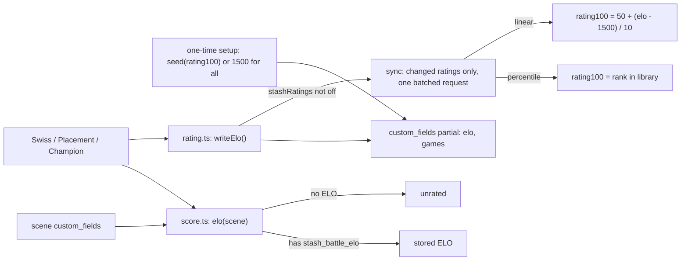

<!-- Working plan for the 3.0 ELO rework. Status and session notes: true-elo-handoff.md -->

# True ELO (all in)

Impact: **Large**. Built in 5 stages, with a review point after each one.

## Decisions

- **One rating system: ELO.** The old 1-100 system goes away.
- **Battle never changes Stash ratings by default.**
  - A **"Stash ratings"** dropdown replaces fun mode. ELO is always saved; the dropdown decides whether and how Stash's rating is written:
    - **Don't update** (default): Battle never writes Stash ratings.
    - **Percentile:** rating = the scene's rank in the library. The top scene is 100, the middle one 50, the bottom one 1, evenly spread. Nothing bunches up at 100, but a rating can shift by a point when another scene passes it.
    - **Straight-line:** rating comes from the ELO number itself (1500 = 50, 10 ELO per point, range 1010-2000), the inverse of `seed`. Gaps between scenes show, and a rating changes only when that scene battles, but very strong or very weak scenes stick at 100 or 1.
  - It starts on **Don't update for everyone after the upgrade**, including existing users who had ratings updating. The setup screen and the CHANGELOG tell them where to turn updates back on.
  - Fun mode ("nothing saved") is removed.
- **The only ways Stash ratings ever change:**
  1. **Switching the dropdown to Percentile or Straight-line** (or between them). A warning shows how many ratings would change, then every rated scene is synced in one go.
  2. **While it's on, every battle** writes the scenes whose Stash rating changed:
     - Percentile: the scenes in the battle plus a few they passed, or more when a new scene joins the ranking.
     - Straight-line: only the scenes whose ELO changed in that battle.
- **One-time ELO setup, chosen by the user.** The first time Battle opens after the upgrade, a setup screen asks two questions:
  1. **How to start ELO:**
     - **Use my ratings:** every rated scene gets a starting ELO from its current Stash rating (`seed`), so the existing order and gaps carry over.
     - **Start everyone at 1500:** every scene starts equal.
  2. **Stash ratings:** the same three options as the Settings dropdown, with Don't update selected by default. Choosing Percentile or Straight-line shows how many Stash ratings would change before confirming.
  - Stash ratings are written only if the second answer isn't Don't update.
- **A Reset ELO button** in Settings re-runs the setup, with a confirmation.
- **After setup, ELO is the only authority.**
  - Battle never reads Stash ratings again, except when Reset ELO is run with "Use my ratings".
  - While Stash ratings are being updated, a star change made in Stash lasts only until Battle next writes that scene.
  - Scenes added later start unrated, even if they were given stars before their first battle.
- **Out of scope:** chess-style brackets (master, grandmaster). They would just be labels drawn from ELO and could be added later without changing any of this.

## What I found (your Stash, v0.31.1)

- Scenes have `custom_fields` (a map). `sceneUpdate` and `bulkSceneUpdate` take `custom_fields: { partial | full | remove }`, and `partial` merges keys. Scenes can be filtered on a custom field.
- **Stash can't sort by a custom field**, so ranking is done client-side. Battle already loads the whole library (`per_page: -1`), so that costs nothing extra.
- Other plugins already use custom fields (`hotornot_stats`, `scene_record`). Our keys are prefixed `stash_battle_`, and writes use `partial` only, so other plugins' fields are never touched.
- Stash's plugin settings page (`stash-battle.yml`) only supports switches, numbers and free-text fields; there's no dropdown. The "Stash ratings" dropdown therefore lives only in Battle's Settings tab and is left out of the yml. That also ensures the warning and sync always run when it changes. It's still saved in the plugin config like the other settings.

## Design

**Stored per scene** (flat numbers, so they can be filtered in Stash's UI):
- `stash_battle_elo`: the scene's ELO.
- `stash_battle_games`: how many rated battles the scene has had. K is worked out from this count, so the thresholds can be retuned without rewriting any scene data.
  - It goes up by 1 for both scenes in every Swiss and Champion battle, since both scenes' ELO moves.
  - Placement (including "Start from the bottom" runs) adds the run's battle count to the scene once, when it lands. Its opponents don't change, so they don't count.
    - These modes never use K, because they set the ELO directly.
    - Counting the run means a placed scene enters Swiss at K 24 (about 10-14 battles in a 600-scene library) instead of a newcomer's 40.
    - `games` means "battles this ELO is based on", so opponents, whose ELO isn't touched, don't count.
  - Stash's `play_count` no longer affects K.

**ELO math** (constants in [src/constants.ts](src/constants.ts) so they can be tuned):
- Standard scale: start 1500, divisor 400, no clamp.
- K is 40 while `games` is under 10, 24 while under 30, then 16. Each scene uses its own K, so a new scene moves a lot while an established opponent moves only a little.
- This replaces the current K based on `play_count`, the shrunken divisor of 40, and the special high K for climbers (`CLIMB_K_PLAY_COUNT`).
- Points don't creep:
  - Every battle in Swiss and Champion moves both scenes.
  - Placement sets a single ELO between two neighbours, so it doesn't add points to the system either.
  - When the two K values differ, the points aren't exactly zero-sum, which happens in chess too. There's no systematic creep, because a newcomer loses points as easily as it gains them.

**Starting ELO from stars** (used only by "Use my ratings"):
- `seed(r) = 1500 + (r - 50) * 10`, which maps 1-100 onto 1010-2000.
- Why 10: the current plugin's ELO divides by 40 on the 1-100 scale, while standard ELO divides by 400. So 1 rating point already means exactly 10 standard ELO points, and the current K of 12/8/6/4 equals 120/80/60/40 ELO. Seeding at 10 keeps every win chance Battle predicted before. For example, a scene rated 20 points higher is still expected to win about 76% of the time.

**Converting ELO to a Stash rating** (both in `score.ts`; used only while the dropdown isn't "Don't update"):
- **Percentile:** `rating100 = 100 - round(99 * i / (N - 1))`, where `i` is the scene's position in the ELO ranking (0 is the top) and `N` is the number of scenes with an ELO. Rounding inside the bracket means a tie at the exact middle gives 50, not 51.
  - The ranking covers the whole library, not the current filter.
  - With a single scene (`N = 1`), it gets 50.
  - Tied scenes use the middle position of their tie group. That way, a library where every scene is at 1500 shows 50 everywhere instead of 100.
- **Straight-line:** `rating100 = clamp(round(50 + (elo - 1500) / 10), 1, 100)`, the exact inverse of `seed`.
  - In effect, it's the current rating system without its cap on the ELO underneath.
  - After a "Use my ratings" setup, Straight-line changes nothing at first, because every scene converts back to its original rating.
  - ELO of 1995 and above shows as 100, and 1014 and below shows as 1.
  - Climbing past the cap is slow: a 2000 scene is expected to beat a 1500 one about 95% of the time, so each such win adds less than 1 point at K 16.
- In both modes, scenes without an ELO aren't written. Almost all of them have no Stash rating anyway. The exception is a scene added after setup that was given stars (by hand or by another plugin) before its first battle: its stars are left alone until it battles and gets an ELO. Before that, it counts as `seed(unratedRating)` in Swiss (1500 by default) without anything being stored.
- Every scene that has an ELO is written, whether or not it has battled. After "Start everyone at 1500", that means every scene's Stash rating becomes 50 at once (all tied), and the warning says so explicitly.
- **Sync after each battle** (one shared function, `syncStashRatings`, for both modes):
  - Work out the target rating for every scene that has an ELO, compare it with the scene's current `rating100`, and write only the ones that differ.
  - The writes are debounced, grouped by value (one `bulkSceneUpdate` per value), and all sent as aliases in **one GraphQL request**.
  - Percentile: a Swiss or Champion battle usually changes only a few scenes. A new scene joining the ranking changes about 1 in 6 of the ratings below it, in a library of 600.
  - Straight-line: only the scenes in the battle (or the one landed scene in Placement).

**One-time ELO setup** (new screen in the Battle tab):
- **When:** shown on the first modal open after the upgrade, after settings load and the capability check, and before the pools load. Battling is blocked until a choice is made.
- **Use my ratings:**
  - Writes `stash_battle_elo = seed(rating100)` and `stash_battle_games = 10` for every scene that has a rating. `games` starts at 10 because the existing rating already says something. It deliberately ignores `play_count`, which counts watches, not comparisons, and isn't changed by Battle.
  - Unrated scenes stay unrated (no ELO).
  - Writes go out as aliased `sceneUpdate` mutations, about 50 per request (roughly 12 requests for your 600 scenes), with a progress screen.
- **Start everyone at 1500:**
  - Writes `stash_battle_elo = 1500` and `stash_battle_games = 0` for every scene, rated or not.
  - Every scene gets the same values, so this is a single `bulkSceneUpdate`.
- **Stash ratings question:**
  - Don't update is preselected. The screen says Battle won't change Stash ratings unless one of the other options is chosen, and that this can be changed later in Settings.
  - For users who had rating updates on before the upgrade, it also says updates now start off.
  - Picking Percentile or Straight-line shows a live count of how many Stash ratings would change for the chosen start, and suggests a backup.
    - Straight-line + Use my ratings: 0.
    - Fresh start + either option: every scene not already at 50, including previously unrated ones (they get an ELO of 1500 too), with a warning that they'll all become 50.
  - The ELO seeding runs first, then the full Stash ratings sync, in one progress screen. The answer is saved as the `stashRatings` setting.
- **Layout:** both questions are shown side by side at the same time (stacked on narrow screens), with one shared preview below them that redraws whenever either answer changes.
- **Preview** (new [src/ui/ratingPreview.ts](src/ui/ratingPreview.ts), styles in [plugins/stash-battle/stash-battle.css](plugins/stash-battle/stash-battle.css)):
  - **The squares:** each row has 10 squares, one per example scene. A square shows its ELO above it (where there is one) and its Stash rating inside it.
  - **Fill:** each square's fill strength follows its rating (stronger means higher), using Stash's theme accent so it fits light and dark themes. Unrated squares are drawn as dashed outlines.
  - **Three rows, top to bottom:**
    1. **Now in Stash:** the scenes' current ratings. These never change with the answers.
    2. **After setup:** the starting ELO (from the first answer) above each square, and the resulting Stash rating inside (from the second answer). Squares whose rating changed get an outline, with "N of 10 change" next to the row.
    3. **After lots of battles:** an example where ELO has spread out, with the Stash rating each option would give then.
  - **Don't update:** the rating squares in rows 2 and 3 keep the current ratings and are greyed out, with "Stash ratings stay as they are".
  - **Example data** (fixed, not your library; computed with the real functions):
    - Now: 100, 100, 96, 85, 74, 70, 62, 45, 20, unrated. The tie at 100 shows today's bunching.
    - After setup, Use my ratings: ELO 2000, 2000, 1960, 1850, 1740, 1700, 1620, 1450, 1200, (unrated).
      - Straight-line: identical to now (0 of 10 change).
      - Percentile: 94, 94, 75, 63, 50, 38, 26, 13, 1, unrated (9 of 10 change; the tied top pair shares 94).
    - After setup, Start at 1500: ELO 1500 for all 10. Both update options give 50 everywhere (10 of 10 change).
    - After lots of battles (the same for both start choices): ELO 2150, 1980, 1700, 1650, 1600, 1550, 1500, 1400, 1250, 1100.
      - Straight-line: 100, 98, 70, 65, 60, 55, 50, 40, 25, 10. The gaps show, but 2150 is stuck at 100 next to 1980.
      - Percentile: 100, 89, 78, 67, 56, 45, 34, 23, 12, 1. The ratings are evenly spaced whatever the gaps.
  - **How it's built:** plain HTML and CSS (flex rows of divs) with no library. The numbers come from the real `seed`, `percentileRatings` and `linearRating` functions, so the preview can't drift from the actual behaviour.
  - **Reuse:** `renderRatingPreview(start, stashRatings)` returns an HTML string, so the Settings dropdown could reuse rows 1 and 3 later.
- **Completion flag:** when setup finishes (seeding and sync), `eloSetupAt` (a timestamp) and `eloSetupMode` (`ratings` or `fresh`) are saved to the plugin config, so the setup screen never shows again on any device.
- **If interrupted:** the flag isn't saved, and the next open shows the setup screen again. Re-running it overwrites the scenes already done, so it's safe to repeat.
- **Reset ELO** (Settings tab):
  - Shows the same two choices after a confirmation that says every scene's ELO will be overwritten.
  - With "Use my ratings", scenes that have an ELO but no Stash rating get their ELO removed (`custom_fields.remove`), so they become unrated.
  - Resets the run, the shuffle and the caches afterwards. If Stash ratings are being updated, a full sync runs right after, and the confirmation says so.
- **Afterwards:** `elo(scene)` returns the stored ELO or null (unrated). Apart from Reset ELO with "Use my ratings", `rating100` is never read again; it's output only.

**"Stash ratings" dropdown** (`stashRatings: "off" | "percentile" | "linear"`, default `"off"`):
- **New control:** the Settings tab has no dropdown yet, so `settingControl` in [src/ui/settingsPanel.ts](src/ui/settingsPanel.ts) gets a `<select data-setting>` case. It's bound on `change`, and `syncSettingsControls` covers selects.
- **Under the dropdown:** a one-line description of the selected option, so the difference is clear without the docs.
- **Don't update:** battles write ELO and `games` only. The Battle tab shows a small note: "Stash ratings aren't being changed · change in Settings".
- **Switching to Percentile or Straight-line** (from any other option):
  - A warning explains what the chosen option does, shows how many scenes' ratings would change, and suggests a backup.
  - Confirming runs a full sync with progress.
  - Cancelling puts the dropdown back to its previous value.
  - If the count is 0 (for example Straight-line right after "Use my ratings"), it switches without a warning.
- **Switching to Don't update:** no confirmation, and nothing is written. Stash ratings keep their last values.
- **Fun mode is removed:**
  - The `funMode` setting goes away, and so does its in-memory copy of every scene (`sandboxScene`, `sandboxPool`, `setSandboxRating`, `savedRating` and `resetSandbox` in [src/cache.ts](src/cache.ts)). That's a real simplification.
  - A saved `funMode` value is ignored, and it disappears from the config on the next save, because `configurePlugin` replaces the whole map.
  - Rating animations always show ELO changes, since ELO is always saved.

**Stash too old:**
- On startup, an introspection check looks for scene `custom_fields`.
- If it's missing, the modal says Battle needs a newer Stash instead of loading.
- Check which Stash version added scene custom fields, for the README's minimum version.

## Mode behavior

- **Swiss:** standard two-sided ELO; both scenes' ELO and `games` change. Unrated scenes start at `seed(unratedRating)`, so the setting keeps its meaning (50 means 1500).
- **Placement:**
  - The search logic stays the same, ranking by ELO.
  - The final ELO is the midpoint of the two neighbouring scenes' ELO, or a neighbour's ELO plus or minus 25 at the top or bottom edge.
  - The integer-gap workaround in `placementRating` goes away.
  - `games` goes up by the number of battles in the run.
  - **"Start from the bottom" option** (`placementFromBottom` setting, off by default; a row in the Settings tab's Battles section and a BOOLEAN in the yml):
    - **Purpose:** a "climb the ladder" run for fun. It ignores the scene's current ELO and makes it prove itself from the bottom.
    - **Start:** the first opponent is the bottom scene of the pool.
    - **Climbing:** each win doubles the jump up the ladder (1, 2, 4, 8... ranks), and a win streak badge counts the wins.
    - **First loss:** the scene's range is now known, and the run narrows it down by halving the range, like normal Placement. It lands with the same midpoint rule and the same `games` increase.
    - **End screen:** shows the streak alongside the usual rank and ELO. Beating the top scene shows the victory screen.
    - **Cost:** a run takes about 12 battles for a scene that belongs near the bottom, 16 for the middle and 18 for the top in a 600-scene library. Normal Placement takes 2-4 battles to confirm a rated scene and about 10 for an unrated one.
    - **Mid-run changes:** changing the setting during a run restarts that scene's run from the new start point. Nothing is lost, because Placement writes only when the scene lands.
    - **How it's built:** `PlacementRun` gets a `fromBottom` flag, read from the setting when the run starts. `nextPlacementIndex` begins at the bottom index and gallops upward. Everything else is shared.
- **Gauntlet is removed as a mode.** It's replaced by the option above.
  - The mode button, its `MODES` entry and its tooltip go.
  - So does all of its code:
    - `fetchGauntletPair`,
    - falling mode (`gauntletFalling`, `gauntletFallingScene`),
    - `gauntletDefeated` and the other `gauntlet*` state in [src/state.ts](src/state.ts) and [src/storage.ts](src/storage.ts),
    - "clear the rating on the first choice",
    - `applyClimbWinRating` and `handleGauntletClimbChoice`,
    - the floor and "winner's rating minus 1" rules,
    - the 100-to-99 rule.
  - A saved `currentMode` of `"gauntlet"` loads as `"placement"`.
  - The Gauntlet end screens in [src/ui/screens.ts](src/ui/screens.ts) are reused for Placement's "Start from the bottom" runs, keeping the streak and the victory screen.
  - The small-pool warning ("Gauntlet and Champion can behave oddly...") now names only Champion.
- **Champion:** winner-stays-on matchmaking, with plain two-sided ELO in every battle.
  - Removed rules: "the climber keeps its rating when it loses", and the 100-to-99 rule.
- **Removed policy layer:** `battleRoleFor` and `applyModePolicy` in [src/ui/mainUI.ts](src/ui/mainUI.ts), and the climber, benchmark and combatant roles in [src/types.ts](src/types.ts). Swiss and Champion both call the same two-sided `resolveComparison`. Placement only writes a rating when the scene lands.

## Stages (review point after each)

1. **ELO core.** (Done; see [true-elo-handoff.md](true-elo-handoff.md) for what was built and verified.)
   - Add `custom_fields` to `SCENE_FRAGMENT` ([src/graphql.ts](src/graphql.ts)) and `Scene` ([src/types.ts](src/types.ts)).
   - Add standard ELO to [src/elo.ts](src/elo.ts) (`eloKFactor`, `eloExpected`, `eloResult`). The pre-3.0 rating100 functions stay until Stage 3 moves the modes over, then get deleted.
   - New [src/score.ts](src/score.ts) with `elo`, `isRated`, `games`, `seed`, `effectiveElo`, `percentileRatings` (ELO ranking to a map from scene id to 1-100), `linearRating` (ELO to 1-100, inverse of `seed`), `compareByElo`, `sortByElo` and `eloInsertionIndex` (named so it doesn't clash with the private `insertionIndex` in `pairs.ts`, which Stage 3 removes).
   - Add the Stash capability check (`sceneCustomFieldsSupported` in `graphql.ts`, checked in `openModal`).
   - Unit tests in `tests/*.test.ts`, run with `npm test` (`scripts/test.mjs` bundles them with esbuild, then runs `node --test`).
2. **Write path and setup.**
   - `writeElo` and `clearElo` in [src/rating.ts](src/rating.ts), each one `sceneUpdate` carrying the ELO custom fields only. `updateSceneRating` stays until Stage 3, because the modes still write rating100 until then.
   - The one-time ELO setup: logic in a new [src/eloSetup.ts](src/eloSetup.ts), and a screen in a new [src/ui/setupScreen.ts](src/ui/setupScreen.ts). It covers both choices, batched writes with progress, and the `eloSetupAt` / `eloSetupMode` flags in the plugin config ([src/settings.ts](src/settings.ts)).
   - Remove fun mode: the setting, the sandbox in `cache.ts`, `ratingsEnabled()`, the fun mode badge and the "not saved" notes on the end screens.
3. **Modes, cache and UI.**
   - Move every `rating100` read and sort in [src/pairs.ts](src/pairs.ts), [src/ui/mainUI.ts](src/ui/mainUI.ts) and [src/cache.ts](src/cache.ts) onto `score.ts`. That covers `repositionSceneInArray`, `insertionIndex`, `findLowestRated`, the placement helpers and `resolveComparison`.
   - Remove the Gauntlet mode and add Placement's "Start from the bottom" option: the `placementFromBottom` setting (types, defaults, `normalize()`, yml, Settings tab row), the `fromBottom` run flag, the streak badge and the victory screen.
   - After each fetch, sort the cache client-side by ELO.
   - Bump `CACHE_DB_VERSION`, and reset saved run state in [src/storage.ts](src/storage.ts) so scene objects saved without custom fields don't survive the upgrade.
   - UI changes:
     - cards show `ELO 1740 · #50` plus the Stash rating ([src/ui/sceneCard.ts](src/ui/sceneCard.ts)),
     - rating animations count ELO deltas,
     - end screens ([src/ui/screens.ts](src/ui/screens.ts)) show the final ELO and rank.
4. **Settings and Stash rating sync.**
   - Add `stashRatings` to `Settings`, `DEFAULT_SETTINGS` and `normalize()` ([src/settings.ts](src/settings.ts)); an unknown value becomes `"off"`.
   - Add it as a dropdown row in the Settings tab ([src/ui/settingsPanel.ts](src/ui/settingsPanel.ts)), with the new select control and the description line. It isn't added to [plugins/stash-battle/stash-battle.yml](plugins/stash-battle/stash-battle.yml).
   - Remove `funMode` from all of these, including the yml.
   - `syncStashRatings` in [src/rating.ts](src/rating.ts): picks the percentile or straight-line target, then debounced, only changed scenes, grouped by value, and sent as one aliased request.
   - Side effects go in `onSettingChanged` ([src/ui/modal.ts](src/ui/modal.ts)): the warning and full sync when switching to Percentile or Straight-line, reverting on cancel, and the "ratings aren't being changed" note.
   - A Reset ELO button in the Settings tab that re-opens the setup choices after a confirmation.
5. **Docs and release.**
   - Rewrite the Rating / ELO System section of [DOCUMENTATION.md](DOCUMENTATION.md) and remove its fun mode notes. Update its Settings, GraphQL and Pitfalls sections.
   - Update the README's How It Works and the K-factor table.
   - Add a CHANGELOG entry that calls out:
     - Stash ratings are no longer changed by default; the "Stash ratings" setting turns updates back on, as Percentile or Straight-line,
     - fun mode is removed,
     - Gauntlet is now Placement's "Start from the bottom" option,
     - the Stash version requirement.
   - Version **3.0.0**, since the rating system changes.

## Review checkpoints (after every stage)

1. **Automated checks:** `npm run typecheck` and the unit tests pass.
2. **Deploy:** `npm run dev` puts the build into the live Stash plugins folder, and the browser reloads `http://localhost:9999/` (F5, since Stash's CSP blocks auto-reload).
3. **Browser checks:** I run that stage's checks from the Testing list below in the browser, with screenshots, and inspect the GraphQL requests (counts, batching, which fields were written) through the browser's DevTools Protocol.
4. **Hand-off:** I stop and report the screenshots, what passed and anything odd. The next stage starts only after you've tried it and said go.

**Test data:** testing runs against your real library. You've already taken a backup.
- Stage 1 is read-only.
- From Stage 2 on, checks write ELO custom fields. Checks that turn on Percentile or Straight-line rewrite Stash ratings.
- At the end of testing, the "Stash ratings" setting is put back to whatever you choose, and the report lists anything written that you might want to roll back from the backup.

## Testing

- `npm run typecheck` after every stage.
- Unit tests for the pure functions with `node --test` (bundled with esbuild, so no new runtime dependency):
  - `seed` across 1-100,
  - the ELO update,
  - the percentile mapping, including ties, a single scene, and every scene tied,
  - the straight-line mapping, including that `linearRating(seed(r)) === r` for every r from 1 to 100, and clamping at both ends.
- Manual check on your Stash:
  - After the upgrade and either setup choice, no Stash rating has changed: compare the scene list sorted by rating before and after.
  - On "Don't update", battles in all three modes change only the ELO custom fields.
  - Switching to Percentile:
    - the warning shows a count,
    - the sync spreads ratings from 1 to 100 by rank, with ties sharing the middle value,
    - Stash's scene list sorted by rating then matches Battle's order.
  - On Percentile, a Swiss battle writes only the few scenes whose rating changed, in a single request (check the browser's network tab).
  - Switching to Straight-line right after a "Use my ratings" setup writes nothing and shows no warning. After some battles, only the battled scenes' ratings change.
  - Switching between Percentile and Straight-line shows the warning and resyncs. Cancelling the warning puts the dropdown back.
  - The setup screen doesn't show again on the next open. An interrupted setup (close the tab partway) shows the screen again.
  - Setup's Stash ratings question:
    - Don't update writes no ratings.
    - Use my ratings + Straight-line shows a count of 0 and writes nothing.
    - Fresh start + Percentile warns that everything becomes 50 and then does so.
    - The chosen option shows in the Settings dropdown afterwards.
    - All six answer combinations redraw the preview with the numbers listed in the design, including the "N of 10 change" counts. It stays readable in both light and dark Stash themes and at narrow widths (the squares shrink rather than wrap).
  - Reset ELO overwrites every scene. Under "Use my ratings", scenes with an ELO but no Stash rating become unrated.
  - With rating updates on, a star edit in Stash is overwritten at the next sync.
  - A new scene with stars but no ELO battles as unrated.
  - Placement with "Start from the bottom":
    - starts at the bottom for both rated and unrated scenes,
    - the jumps double while the scene keeps winning, and the range narrows after its first loss,
    - it lands in about 12-18 battles,
    - opponents' ELO doesn't change, and the end screen shows the streak (and the victory screen after beating the top scene).
  - Turning the option on or off mid-run restarts that scene's run, with nothing written.
  - With it off, Placement behaves as before.
  - A saved Gauntlet mode loads as Placement.
  - Champion: the loser's ELO drops and the winner takes over.
  - All three modes, a filtered pool, and a battle started from a scene page.

## Risks and edge cases

- **Existing users lose automatic rating updates unless they opt back in.** That's deliberate: the setup screen preselects Don't update. Its Stash ratings question, and the CHANGELOG, tell them how to turn updates back on (Straight-line with Use my ratings is the closest match to today's behaviour).
- **A fresh start with updates on flattens every Stash rating to 50.** That's deliberate, but destructive. The warning has to say so plainly and show the count.
- **Percentile reshapes ratings.** Percentile ratings are spread evenly, so most scenes' ratings change once when it's turned on. A scene a user rated 100 by hand may become 97. The warning has to say this and show the count.
- **Percentile ratings are relative.** A 50 means "the middle of my library", not "decent". Adding or placing a scene nudges others by a point, and each changed scene's "updated" time in Stash changes.
- **Straight-line bunches at the ends.** ELO has no cap, so scenes that keep winning pile up at 100 (and losers at 1) over time, and Stash can't tell them apart. Battle's own ranking is unaffected. The dropdown's description should mention this.
- **Switching between the two** rewrites many ratings each time. The warning covers this, but people experimenting should take a backup first.
- **Top scenes can lose ELO in Champion.** Beaten opponents now lose ELO there. Established scenes have a lower K, so a single upset moves them only a little.
- **Gauntlet users lose a mode button.** The climb now lives under Placement's "Start from the bottom" setting. It also jumps up the ladder (1, 2, 4, 8... ranks) instead of fighting every nearby scene in turn, and it no longer falls step by step after a loss. Runs are much shorter. The CHANGELOG and the Placement tooltip should point Gauntlet users to the setting.
- **Star edits get overwritten.** While Stash ratings are being updated, manual star edits (and changes from other plugins or tools) last only until the next sync. The README needs to say this plainly.
- **New scenes with stars:** a scene added after setup with stars but no ELO battles as unrated. It also won't match Stash filters like "rating is null", so it can't be singled out with a filter for unrated scenes.
- **Rating-based filters stop shrinking on "Don't update".** Filters like "rating is null" don't shrink as you battle, because Stash ratings aren't being written. Filtering on the `stash_battle_elo` custom field works instead, and the README should mention it.
- **Cache size:** fetching `custom_fields` includes other plugins' JSON, so the cache gets slightly bigger.
- **Number round-trip:** custom field values have to come back as numbers. `score.ts` already accepts numeric strings as a fallback. Confirm the real type once Stage 2 writes the first values; the other plugins' existing fields come back as strings, but they store JSON text.
